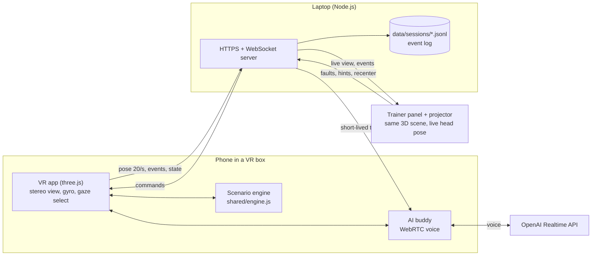
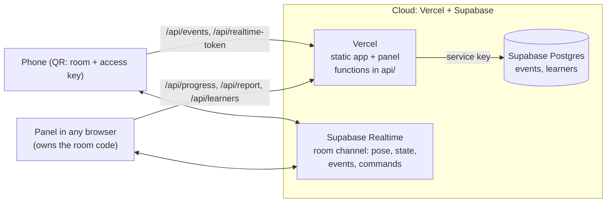
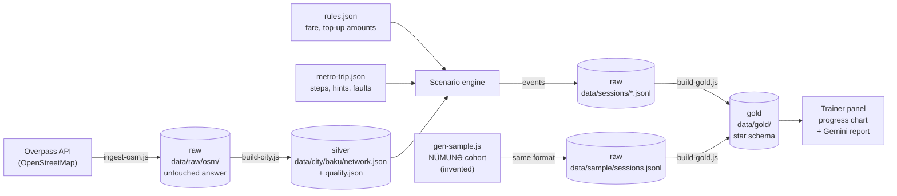
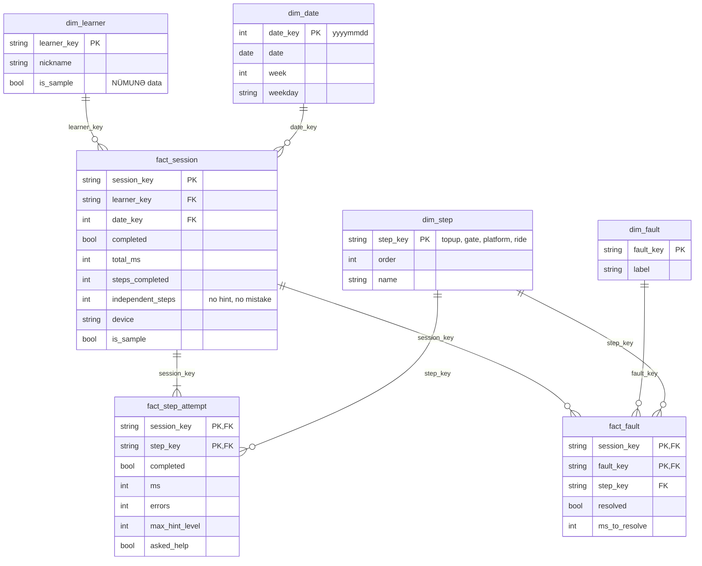

# UMATE: practise the metro in VR first, then go alone

**Team Artemis** · YUNEX 2026 hackathon, Digital Inclusion track · [Azərbaycanca](README.az.md)

UMATE is a phone + low-cost VR box trainer for young people with cognitive differences (for example
intellectual disability or autism). They rehearse a real Baku Metro trip with BakıKart payment
in photoreal 360° scenes, with a voice AI buddy at their side. A trainer follows every step live on
a laptop and can add real-life problems (card not read, train delayed...) at the right moment.

[Concept paper (English, PDF)](docs/UMATE-concept-EN.pdf) · [Konsepsiya (Azərbaycanca, PDF)](docs/UMATE-concept-AZ.pdf) · [3-minute pitch and demo script](docs/pitch/PITCH-3MIN.md)

---

## 1. Purpose

**The problem.** Many young people with cognitive differences never travel alone. The metro is
fast, loud and full of small decisions: top up the card, pass the turnstile, pick the right
direction, get off at the right stop. One mistake in real life (a refused card, a wrong platform)
can be frightening enough to stop trying. Today they practise only in the real metro, with a trainer
or a parent next to them, which is slow, costly and stressful.

**The solution.** Practise the exact trip first, safely, as often as needed:

1. The learner wears a cheap VR box with their own phone and sees a real-looking Baku Metro station.
2. They do the 4 steps of the trip by looking at things: top up the BakıKart, tap the card at the
   turnstile, choose the platform sign for the right direction, ride and get off at the right station.
3. If they are stuck, help grows step by step: first a spoken hint, then the target glows. Asking
   the AI buddy for help counts as a good choice, not as a mistake.
4. The trainer (or a judge on stage) injects one of 4 real-life problems from the laptop and sees
   how the learner copes.
5. Every action is logged, so the trainer can see progress over time.

**Why it fits the track.** Digital inclusion is not only access to apps; it is the confidence to use
everyday digital services, such as contactless payment and transport, independently.

**What it is not.**

- Not a medical device or a therapy, and it does not diagnose anything.
- Not a navigation app for the real trip (a "guide mode" for the real trip is on the roadmap).
- Not a replacement for the trainer: the trainer decides when someone is ready.
- Sample data labelled **NÜMUNƏ** (sample) is invented for the demo and is never evidence that the method works.

## 2. A short story (fictional)

Aysel is 17 and autistic. She lives near **Koroğlu** station and wants to join a course near
**28 May**, four stops away. Her mother has taken her every day for a year, because the one time
Aysel tried alone, the turnstile beeped red and she went home in tears.

At the centre, her trainer opens UMATE. Aysel puts on the VR box and is standing in the Koroğlu
hall. She tops up her card and taps it at the turnstile. On the platform she hesitates between two
signs; after a while the buddy says softly: *"Read the station names on each sign. Which sign shows
28 May?"* She picks the left one. The trainer presses **Card not read** in the next session, and
Aysel learns that the answer is simply to hold the card still and try again.

After a few sessions the panel shows she no longer needs hints at the turnstile but still hesitates
on the platform, so the trainer focuses on that. The first real trip is planned when the log says so.

## 3. How it works



- **No video is streamed.** The phone sends its head direction 20 times a second and the panel draws
  the same scene itself, so the projector view stays smooth on any laptop.
- **The engine is the single source of truth.** The AI buddy only receives facts from the engine
  (stations, balance, step), so it cannot invent a wrong station or price.
- **The API key never reaches the phone.** The laptop asks OpenAI for a short-lived client secret.

### 3.1 Two ways to run: cloud (Vercel + Supabase) or laptop

The same browser code runs in both; it asks `/api/config` where it is running.



| | Cloud (Vercel + Supabase) | Laptop server (`npm start`) |
|---|---|---|
| Link | permanent, for example `https://<project>.vercel.app` | Wi-Fi link or a free tunnel link that changes |
| Phone ↔ panel | Supabase Realtime broadcast on a room channel (pose 10/s) | WebSocket hub on the laptop |
| Session log | Supabase table `events` | `data/sessions/*.jsonl` |
| Needs internet | yes | no (only the live AI voice does) |
| Use it for | the demo and the pilot | backup on stage without internet |

- **Pairing:** each panel creates a room code; its QR code carries `room` and the access key to the
  phone (`/vr/?room=…&k=…`). The key is removed from the address bar after loading.
- **Security:** the Supabase tables have row level security with no policies, so browsers cannot read
  or write them; only the functions can, with the secret key. Every function except `config` and `qr`
  needs the access key (`UMATE_ACCESS_KEY`), so nobody else can spend the OpenAI or Gemini credit.
- **Schema:** `supabase/schema.sql`.

**Deploy:** import the GitHub repository in Vercel (framework: Other; `vercel.json` sets the build
`npm run build:web` and the output `public/`), then add the environment variables `OPENAI_API_KEY`,
`GEMINI_API_KEY`, `SUPABASE_URL`, `SUPABASE_ANON_KEY` (publishable key), `SUPABASE_SERVICE_ROLE_KEY`
(secret key) and `UMATE_ACCESS_KEY`. Every push to `main` deploys again. Open
`https://<project>.vercel.app/panel/?k=<UMATE_ACCESS_KEY>` once on the trainer's computer.
`npm run dev:cloud` runs the cloud version locally on port 3000 for testing.

## 4. Data sources

| Source | What we take | How | Licence |
|---|---|---|---|
| OpenStreetMap (Overpass API) | Every Baku Metro route, stop, station name and coordinate | `npm run data:ingest` | ODbL 1.0 |
| Ministry of Digital Development and Transport | Single metro fare: **0.60 AZN** from 1 October 2025 ([announcement](https://mincom.gov.az/en/media-en/news/approval-of-new-fares-for-metro-and-bus-routes-with-cashless-payment-systems-and-modern-standards)) | Typed into `rules.json`, verified 2026-11-08 | Public information |
| Wikimedia Commons photos (Koroğlu platform, Bakmil turnstiles and BakıKART machine) | Visual reference only, for generating the 360° panoramas | Not stored in the repository | Per photo |
| UMATE itself | Learner session events | Written by the server while the app runs | Stays on the laptop, never committed |

## 5. Data pipeline and model

The pipeline follows the raw → silver → gold layers of the YUNEX reference demo.



| Layer | Where | What it holds | Status |
|---|---|---|---|
| raw | `data/raw/osm/baku-metro.json` + `.meta.json` | The Overpass answer exactly as returned, with time, source, query and licence | Done |
| silver | `data/city/baku/network.json` | 4 lines, 26 stations, every route variant; Azerbaijani + English names, coordinates | Done |
| quality report | `data/city/baku/quality.json` | Problems found in the source data (see below) | Done |
| config | `rules.json`, `data/scenario/metro-trip.json` | Fare, top-up amounts, steps, hint texts, faults | Done |
| raw (sessions) | `data/sessions/<session>.jsonl` | One line per event, written by the server, with the learner profile | Done |
| raw (sample) | `data/sample/sessions.jsonl` | NÜMUNƏ cohort: 10 invented learners, about 80 sessions, same format, every line `"sample": true` | Done |
| gold | `data/gold/*.json` + `*.csv` | Star schema below; every key checked; CSV for Excel or Power BI | Done |

`data/sessions/`, `data/sample/` and `data/gold/` are generated and never committed. The panel computes
the gold tables on the fly (a few thousand lines take milliseconds); `npm run data:gold` writes them to
disk.

### 5.1 Data quality

The build checks the source data and stops on errors. The current OpenStreetMap snapshot passes
with warnings that the build fixes:

| Check | Found | What the build does |
|---|---|---|
| English name missing in OSM | 10 of 26 stations (Koroğlu, 28 May, Gənclik, ...) | Uses the hand-checked list in `names-en.json`, then OSM `name:en`, then automatic transliteration. The source of every name is recorded |
| Inconsistent English names | "Nariman Narimanov station", "Halglar Dostlugu" | Hand-checked list wins |
| Extra words in names | "20 Yanvar st." | Cleaned to "20 Yanvar" |
| Line colour | OSM says only "red", "green", "purple" | Official colours: Red `#EE1D23`, Green `#00AB5B`, Purple `#8E177C` |
| Missing stop, missing name, missing coordinates, duplicate id | none | Would stop the build |

A rebuild without new raw data produces exactly the same file (no build time inside), and a test checks this.

### 5.2 Event dictionary (implemented)

Every engine event is logged with the session id, the step and a timestamp.

| Event | Meaning | Main fields |
|---|---|---|
| `session_start` | A trip starts | trip, from, to, stops |
| `step_enter` / `step_complete` | A step starts / ends | id; on complete: `ms`, `errors`, `maxHintLevel`, `askedHelp` |
| `wallet` | Any money movement | tx (`topup`, `fare`, `fault_set_balance`), amount, balanceBefore, balanceAfter, ok |
| `error` | A mistake, handled gently | reason: `insufficient_balance`, `card_not_read`, `wrong_direction`, `exit_too_early`, `missed_stop`, `invalid_amount` |
| `hint_shown` | Help was given | level 1–3, trigger (`idle`, `ask`, `trainer`), text, target |
| `help_asked` | The learner asked the buddy | |
| `fault_injected` / `fault_resolved` | A trainer challenge starts / ends | fault, by |
| `choice`, `boarded`, `arrive_station`, `announcement`, `return_trip` | Trip progress | station, stopsLeft, ... |
| `session_end` | The trip is finished | completed |

**Rule:** a refused payment never changes the balance (tested).

### 5.3 Gold layer: star schema



| Table | Grain (one row is...) | Primary key |
|---|---|---|
| `fact_session` | one trip attempt | `session_key` |
| `fact_step_attempt` | one step entered in a session (an unfinished step is kept with `completed = false`) | `session_key, step_key` |
| `fact_fault` | one trainer challenge in a session | `session_key, fault_key` |

Parquet-free tables do not enforce keys, so `checkKeys()` and the tests check that every foreign key
points to a dimension row and that no primary key repeats.

### 5.4 Progress, readiness rule and trainer report

- **Steps done alone** (`independent_steps`): steps finished without a hint and without a mistake, 0–4.
  The panel's "Progress and report" view draws it session by session for a learner, next to the
  NÜMUNƏ average (dashed, labelled "invented sample").
- **Readiness rule** (simple and explainable, not a model): the last 3 completed sessions each had at
  least 3 of 4 steps done alone. The panel shows it as "Readiness rule met: trainer may plan a first
  real trip" or "Not ready yet". The trainer decides.
- **Practise next:** the step that needed the most hints and mistakes in the last 5 sessions.
- **Trainer report:** Gemini (`gemini-3.5-flash`, then `gemini-2.5-flash`) writes 4–6 plain sentences
  from these computed facts only, never from raw logs or audio. Without a key, internet or a free model,
  a template report is built from the same facts. Reports about sample learners end with a NÜMUNƏ note.

The roadmap model (readiness prediction) will learn from `fact_step_attempt` together with the
trainer's record of the real trip, and replace the rule.

## 6. Scenario engine

`shared/engine.js` is a pure, deterministic state machine. The same code runs on the phone and in the
tests. It never reads the clock: every action carries its own time, so the same actions always give
the same result. Money is counted in qəpik (integers) to avoid rounding errors.

| Step | Learner does | Engine checks |
|---|---|---|
| 1. Top up | Opens the BakıKART machine, holds the card, picks 1, 2 or 5 AZN | Only offered amounts; card can fail to read (fault) |
| 2. Turnstile | Taps the card | Balance ≥ fare (0.60 AZN), else refused without charging |
| 3. Platform | Chooses the sign for the right direction | Direction computed from the OSM line order for any station pair |
| 4. Ride | Rides in a Baku Metro 81-765 car, listens to the announcements, gets off at the destination | Too early is refused; a missed stop leads to a ride back |

**Hints** rise after 8, 15 and 25 seconds without progress: level 1 is a spoken and written hint,
level 2 makes the target glow, level 3 is the most direct hint. Looking at the buddy for 1.5 seconds
also asks for help.

**Trainer challenges (faults):**

| Fault | What happens |
|---|---|
| Not enough balance | The card balance drops to 0.20 AZN; the turnstile refuses; the learner tops up again |
| Card not read | The next tap fails without charging; the second tap works |
| Train delayed | An announcement says the train is about 3 minutes late; the buddy offers a calm breath; the train comes when the delay ends |
| Crowd and noise | A crowd sound fades in; the buddy offers a short breathing exercise |

## 7. Run it

Needs [Node.js](https://nodejs.org) 24 or newer.

```bash
npm install          # once
cp .env.example .env # then add OPENAI_API_KEY (and GEMINI_API_KEY for reports later)
npm start            # prints the links for the phone and the panel
```

| Mode | Needs internet | What works |
|---|---|---|
| Full | Yes (Wi-Fi or a phone hotspot) | Everything, including the AI buddy's voice |
| Offline | No | VR, panel, engine, hints, faults, logging. The buddy speaks recorded lines (`client/assets/voice`, made with `npm run voice:gen`); a line without a recording is spoken by the phone's own speech engine |
| Rebuild the data | Yes for `data:ingest`, no for `data:build` | `npm run data:ingest` refreshes the OSM snapshot; `npm run data:build` rebuilds `network.json` |
| Analytics | No (Gemini report needs internet; the template report does not) | `npm run data:sample` creates the NÜMUNƏ cohort; `npm run data:gold` writes the star schema (add `-- --real` for real sessions only) |

- **Panel (projector):** `https://localhost:8443/panel/`
- **Phone (recommended): the public link.** `npm start` also opens a free tunnel and prints a
  `https://…/k/<key>` link; the QR code on the panel switches to it. It works from any network
  (venue Wi-Fi, mobile data) with a normal certificate, so nothing has to be installed on the phone.
  The `<key>` part is a random access key made at each start: without it the public address only
  shows "scan the QR code", and the AI token and live link are refused. Providers, tried in order:
  1. Cloudflare quick tunnel: fastest, no time limit. Needs
     [cloudflared](https://github.com/cloudflare/cloudflared/releases) in `tools/bin/` or on the PATH.
  2. Pinggy over SSH: no install. Shows a one-time "Enter site" page on the phone (tap it once).
     Free links last 60 minutes, then a new link and QR code appear: start the server shortly
     before the demo.
  3. localhost.run over SSH: last resort, very slow.

  Set `UMATE_TUNNEL=0` to switch the tunnel off.
- **Phone on the same Wi-Fi (backup, works without internet):** open `https://<laptop-ip>:8443/vr/`.
  The first time on each phone, open `http://<laptop-ip>:8080/` and install the local certificate
  (the page explains the steps for Android and iPhone). Some venue Wi-Fi networks block
  phone-to-laptop traffic; a phone hotspot that both devices join avoids that.

| In VR | How |
|---|---|
| Look around | Turn your head (gyroscope) |
| Select | Look at a thing for 1.5 s; the VR box button, a screen tap or a remote selects at once |
| Walk | Look at the green circle on the floor |
| Talk to the buddy | Look at the glowing orb; talk when its ring lights up |

**Trainer panel:** pick the learner in the header (or add one; real nicknames are stored only in
`data/learners.local.json` on the laptop). The right column shows the trip as a metro line, one stop per
step, with time and help used. "Challenges for the judge" starts or stops each of the 4 faults.
"Progress and report" opens the chart and the trainer report. "Short ride" shortens the train ride to about 25 seconds for a stage demo.

## 8. Tests

```bash
npm test         # 41 unit tests (node:test)
npm run check    # syntax check of every JavaScript file
```

- every pair of Red line stations: direction, stop count and the right platform sign;
- all 4 faults, including "a refused payment never changes the balance";
- graduated hints, help asked, wrong direction, getting off too early, missed stop;
- determinism: the same actions give the same states and events;
- the rules file drives behaviour: a higher fare makes 1 AZN not enough;
- data: the rebuild of `network.json` is exact, the Red line order is the real one, every station has
  both names and coordinates inside Baku, and broken input is reported;
- analytics: logs produced by the real engine become the right star rows (mistakes, hints and help per
  step, unfinished steps, challenges), keys are valid, the readiness rule, the NÜMUNƏ sample is
  deterministic and labelled on every line, and real and sample sessions stay separable.

## 9. Repository layout

```
client/   vr/ (phone app), panel/ (trainer panel), setup.html (certificate), assets/ (panoramas, fonts)
shared/   engine.js (scenario engine), analytics.js (gold layer), world.js (3D scene), ui3d.js, buddy.js, data.js
server/   laptop server: HTTPS + WebSocket, tunnel, OpenAI token, Gemini report, JSONL event log, certificates
api/      cloud functions for Vercel (config, events, learners, progress, report, realtime-token, qr)
supabase/ schema.sql for the cloud database
data/     raw/osm/, city/baku/ (network, rules, names), scenario/, learners.json;
          generated, not committed: sessions/, sample/, gold/
tools/    ingest-osm.js, build-city.js, gen-sample.js, build-gold.js, gen-voice.js, build-web.js, dev-cloud.js, check-syntax.js
tests/    engine, network, analytics, voice and cloud API tests
docs/     concept paper (AZ + EN)
```

## 10. Status and roadmap

- [x] Phase 0: VR viewer, gaze input, live panel, AI buddy, HTTPS server
- [x] Photoreal Baku Metro scenes, Baku-style signage
- [x] Phase 1: OSM data pipeline, scenario engine, faults, hints, tests
- [x] Phase 2: train ride scene (81-765 car), station announcements, doors, arrival summary; public link
- [x] Phase 3: trainer panel for the projector (trip as a metro line, challenges, learner profiles)
- [x] Phase 5: gold star schema, progress chart with the **NÜMUNƏ** sample cohort, Gemini trainer report
- [x] Phase 4: recorded buddy voice (Gemini text-to-speech) when the live AI voice is not available
- [ ] Roadmap: real-trip guide mode; readiness prediction model trained on VR sessions + real-trip outcomes

## 11. Credits and licences

- Code: [MIT](LICENSE).
- Map data © OpenStreetMap contributors, ODbL 1.0.
- Font: [Atkinson Hyperlegible Next](https://www.brailleinstitute.org/freefont/) by the Braille Institute, SIL OFL 1.1.
- 360° panoramas: generated with an image model from public reference photos of Baku Metro stations
  (Wikimedia Commons); the photos themselves are not in the repository.
